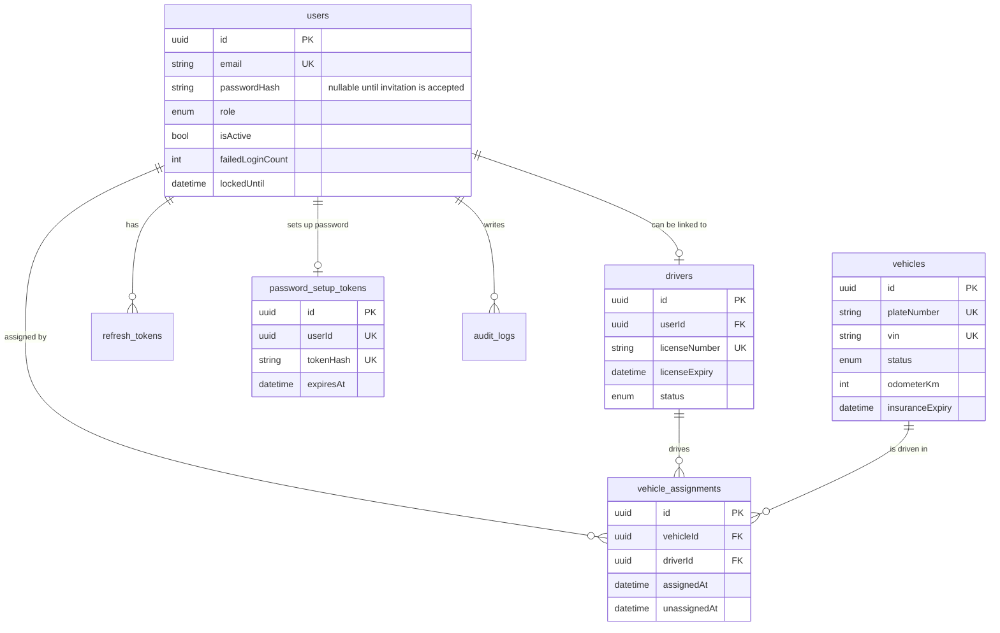

# Database

PostgreSQL, managed with Prisma. The model lives in `apps/api/prisma/schema.prisma`.

## Tables



| Table | What it holds |
| --- | --- |
| `users` | Login accounts and their role. Passwords are stored only as bcrypt hashes. |
| `refresh_tokens` | One row per refresh token issued. Lets us revoke and detect reuse. |
| `password_setup_tokens` | A single-use, hashed password setup token for each invited account. |
| `drivers` | The people who drive. A driver may be linked to a login (`userId`). |
| `vehicles` | The fleet. |
| `vehicle_assignments` | History of who had which vehicle. **`unassignedAt IS NULL` means "current".** |
| `audit_logs` | Who did what, and when (create, update, delete, assign, login events). |

## Rules worth knowing

- A vehicle has **at most one** open assignment, and a driver has at most one too. The
  `assign` service function checks both inside a Serializable transaction.
- Vehicle status `IN_USE` is only ever set by assigning, never by editing the vehicle.
- Vehicles and drivers with history can't be deleted (foreign keys use `Restrict`).
  Mark them Retired / Suspended instead.
- Foreign keys: deleting a user removes their refresh tokens but keeps audit rows
  (`SetNull`).

## Where the complex queries are

| Query | File | Prisma features used |
| --- | --- | --- |
| Vehicle list with search, filters, sorting, current driver | `modules/vehicles/vehicle.service.ts` `list` | nested `OR`, relation filters (`some`/`none`), `$transaction` for count + rows, `include` with `where` |
| Assign / unassign vehicle | `vehicle.service.ts` `assign`, `unassign` | interactive transaction, Serializable isolation |
| Driver list ("licence expiring", "has vehicle") | `modules/drivers/driver.service.ts` `list` | relation filters, whitelisted dynamic `orderBy` |
| User list that hides super admins from others | `modules/users/user.service.ts` `list` | composed `AND` filters |
| Dashboard summary | `modules/dashboard/dashboard.service.ts` | `groupBy` with `_count` and `_avg`, parallel queries, `$queryRaw` with `date_trunc` |
| Refresh token rotation | `modules/auth/auth.service.ts` `refresh` | transaction, `updateMany` for "sign out everywhere" |

## Indexes

Added where list pages filter or sort:

- `vehicles (status, type)`, `vehicles (insuranceExpiry)`
- `drivers (status, licenseExpiry)`, `drivers (lastName, firstName)`
- `vehicle_assignments (vehicleId, unassignedAt)` and `(driverId, unassignedAt)`: these make
  "who has this right now?" fast
- `vehicle_assignments (assignedAt)`: for the monthly chart

## Optional hardening: one open assignment per vehicle, enforced by the database

The service already prevents double assignment, but a database rule is a stronger guarantee.
Create an empty migration and add partial unique indexes:

```bash
npx prisma migrate dev --create-only --name one_open_assignment
```

Then put this in the generated `migration.sql` and run `npm run db:migrate` again:

```sql
CREATE UNIQUE INDEX one_open_assignment_per_vehicle
  ON vehicle_assignments ("vehicleId") WHERE "unassignedAt" IS NULL;
CREATE UNIQUE INDEX one_open_assignment_per_driver
  ON vehicle_assignments ("driverId") WHERE "unassignedAt" IS NULL;
```

Prisma can't express partial indexes in `schema.prisma`, which is why this is a manual step.

## Everyday commands

| Task | Command |
| --- | --- |
| Change the model, then update the DB | edit `schema.prisma`, then `npm run db:migrate` |
| Deploy migrations (CI / production) | `npm run db:deploy` |
| Look at the data | `npm run db:studio` |
| Bootstrap the first super-admin | Set the `SUPER_ADMIN_*` variables in `.env`, then run `npm run db:seed`. Existing data is not deleted and demo fixtures are not inserted. |
| Reset everything locally | `npx prisma migrate reset` (deletes all data) |
